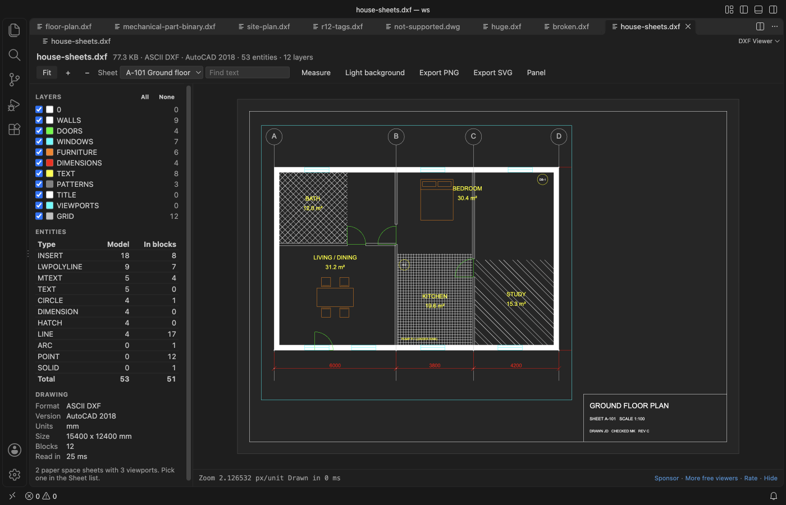
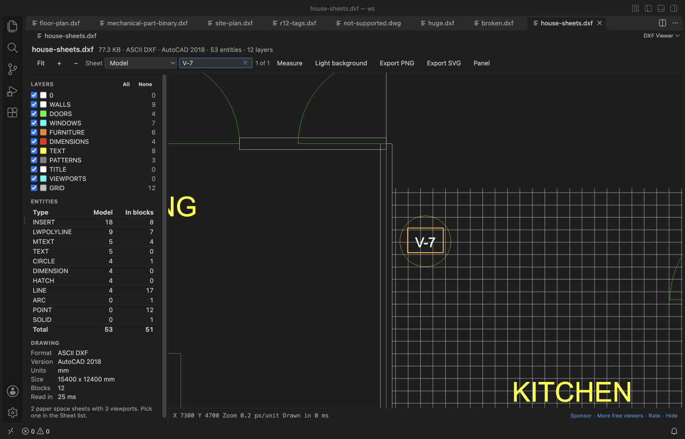
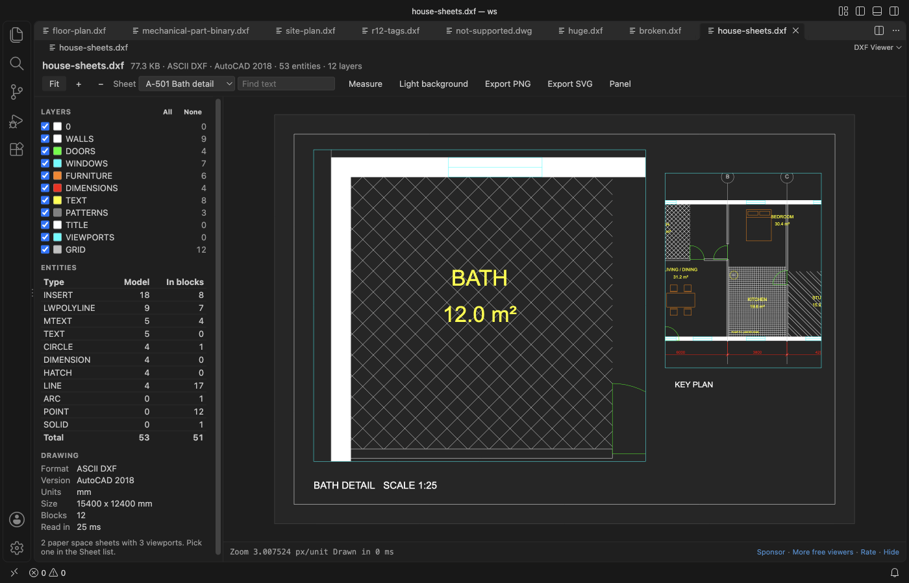

# DXF Viewer & CAD Viewer for 2D Drawings

Open `.dxf` drawings in VS Code and check sheets, layers, sizes and distances without leaving the editor or starting a CAD program.

*Screenshot of VS Code 1.142 with `house-sheets.dxf` made by `scripts/make_sheet_sample.py`.*

- Sheets (paper space layouts): pick a layout in the Sheet list and see it the way it prints: title block, viewports at their scale, and layers frozen in a single viewport left out.
- Hatch patterns: ANSI31, NET, brick and other pattern hatches are drawn as their real lines, cut at the boundary and around islands.
- Find text: Ctrl+F (Cmd+F on a Mac) finds text, MTEXT and block attributes such as tag numbers, and zooms to each match.
- Live reload: export the DXF again from your CAD program and the open view updates, with the same zoom, sheet and layers.
- Reads ASCII and binary DXF, from R12 to AutoCAD 2018 files, with blocks, nested inserts, text and dimensions. Hide or show each layer, and measure with snapping to ends and centres.
- Save the view as a PNG image or an SVG file for a ticket, a pull request or the docs. Works offline. The drawing is never changed.

## Quick start

1. Install DXF Viewer & CAD Viewer for 2D Drawings.
2. Click a `.dxf` file in the Explorer.

## What you can do

| Action | How |
|---|---|
| Switch sheet | Pick Model or a layout in the Sheet list. Only drawings with paper space show the list |
| Find text | Type in Find text, or press Ctrl+F (Cmd+F). Enter goes to the next match and Shift+Enter to the one before. It searches the sheet on screen and skips hidden layers |
| Pan | Drag with the mouse, or use the arrow keys |
| Zoom | Scroll at the point you want, or the + and − buttons |
| Fit the drawing | Fit button, F, or a double-click |
| Hide a layer | Untick it in the Layers panel. All and None switch every layer |
| Measure | Measure button or M, then click two points. You get the distance in the drawing units, ΔX, ΔY and the angle. Copy puts the line on the clipboard |
| Background | Dark like most CAD programs, or white like a printed sheet (B) |
| Export | Export PNG saves the view at twice the screen resolution. Export SVG saves the visible layers as paths and text |

The side panel lists the layers with their colour and entity count, a table of entity types (model space and inside blocks), and the drawing facts. These are ASCII or binary, the DXF version, units, size and block count. Layers that are off or frozen in the file start hidden.

## What gets drawn

LINE, CIRCLE, ARC, ELLIPSE, LWPOLYLINE and POLYLINE (bulges too), SPLINE, POINT, SOLID, TRACE, 3DFACE, HATCH, TEXT, MTEXT, ATTRIB, INSERT with arrays and nested blocks, DIMENSION, LEADER and VIEWPORT. Dimensions use the block the CAD program saved with them, and when it's missing the viewer draws them from their definition points.

Pattern hatches use the pattern lines stored in the DXF file, with their angle, spacing and dashes. When you zoom out so far that the lines would sit less than 2 pixels apart, the hatch shows as a light tint until you zoom in again. A pattern with more than 4,000 lines in one hatch also shows as a tint, and the panel says so.

Paper space sheets come from the LAYOUT objects in the file, in their tab order. Each viewport shows model space at its own scale and twist, clipped to its frame, without the layers it freezes. Files with paper space but no layout list (R12) get one sheet.

Colours follow the layer, the block or the entity (ACI and true colour). Dashed and centre linetypes come from the file. Other entity types, such as 3DSOLID, IMAGE or XLINE, are counted in the table and marked as not drawn.

## DWG files

DWG isn't supported. It's a closed binary format with no permissively licensed reader. When you click a `.dwg` file, DXF Viewer shows a short page with the DWG version and how to get a DXF copy.

- AutoCAD, AutoCAD LT or DWG TrueView. Use Save As (or DXFOUT) and pick an AutoCAD DXF type.
- BricsCAD, ZWCAD or DraftSight. Use Save As and pick DXF.
- LibreCAD, QCAD or FreeCAD. Open the DWG and save it as DXF.
- The free ODA File Converter converts a whole folder of DWG files at once.

If you use another extension for DWG files, the page has a button to reopen the file with it.

## Big files

The file is read in a worker thread, so VS Code stays responsive while it loads. A 24 MB drawing with 600,000 lines is read in about one second. Files over 500 MB show a message and are not read (setting `dxfViewer.maxFileMB`, up to 2048).

## Settings

| Setting | Default | What it does |
|---|---|---|
| `dxfViewer.maxFileMB` | 500 | Largest file to read. |
| `dxfViewer.background` | auto | Background when a file opens. `auto` follows the VS Code theme. |
| `dxfViewer.liveReload` | true | Read the drawing again when the file changes on disk. |
| `dxfViewer.askForRating` | true | Ask one time for a rating after a few days of use. |

## Privacy

DXF Viewer makes no network calls and sends no telemetry. The webview runs under a strict Content Security Policy, and text from the drawing is drawn as text, never as HTML. The only file it writes is an export you pick in the save dialog, and it refuses to write over a drawing.

## Limits

- Viewports are drawn as rectangles. A viewport clipped to a polygon shows its rectangular frame, and a 3D view direction is drawn as a top view.
- 3D entities are drawn flat (top view). 3DSOLID, REGION and BODY hold ACIS data and are not drawn.
- Text uses a sans-serif font, not the SHX or TrueType font named in the file, so text widths differ a little from CAD.
- Line weights are not used. Every line is one pixel wide at any zoom.
- Hatch gradients show as a solid fill in the hatch colour.

## Support Zovo

Zovo extensions are free, with no ads and no tracking. They are made by [theluckystrike](https://github.com/theluckystrike) on GitHub. If this one saves you time, you can support the work:

- [Sponsor on GitHub](https://github.com/sponsors/theluckystrike)
- [Follow theluckystrike on GitHub](https://github.com/theluckystrike)

## More tools by Zovo

- [3D Model Viewer (GLB, glTF, STL, OBJ, PLY)](https://marketplace.visualstudio.com/items?itemName=zovo.3d-model-viewer) views GLB, glTF, STL, OBJ, PLY and 3MF models.
- [GCode Viewer & 3D Print Preview](https://github.com/theluckystrike/gcode-viewer-vscode) shows GCode toolpaths in 3D layer by layer, with print time and filament use.
- [PDF Viewer & PDF Reader with Dark Mode](https://marketplace.visualstudio.com/items?itemName=zovo.pdf-viewer-dark) reads PDFs with a real dark mode, search, an outline and thumbnails.

See [all Zovo extensions on the Marketplace](https://marketplace.visualstudio.com/publishers/zovo).

## License

MIT. DXF Viewer uses no third-party runtime code. The DXF reader, the renderer and the sample drawings were written for this extension.
