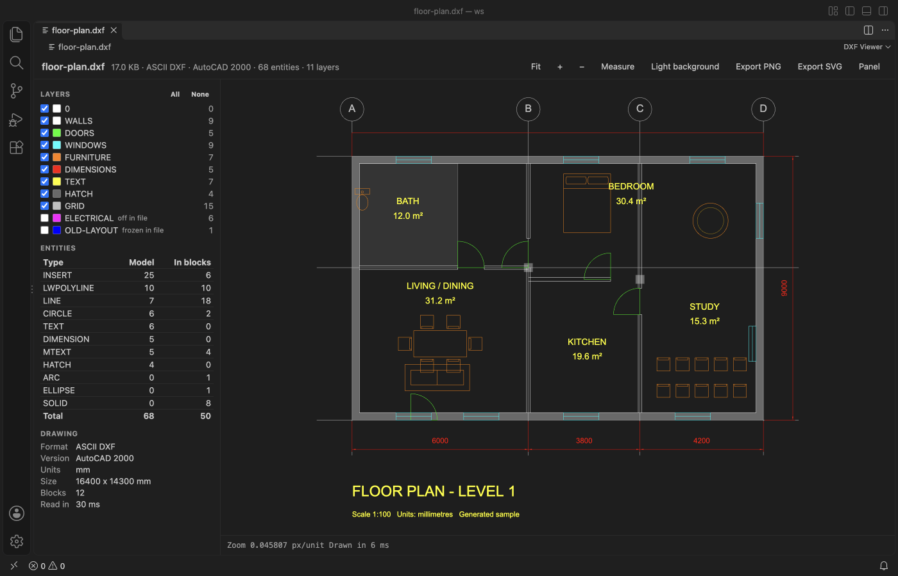
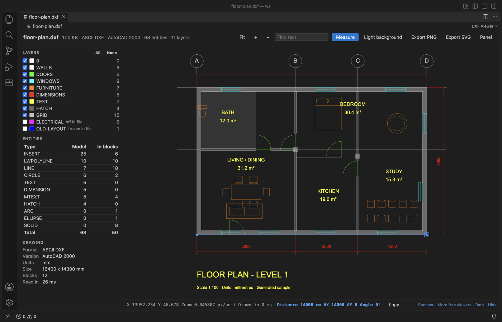
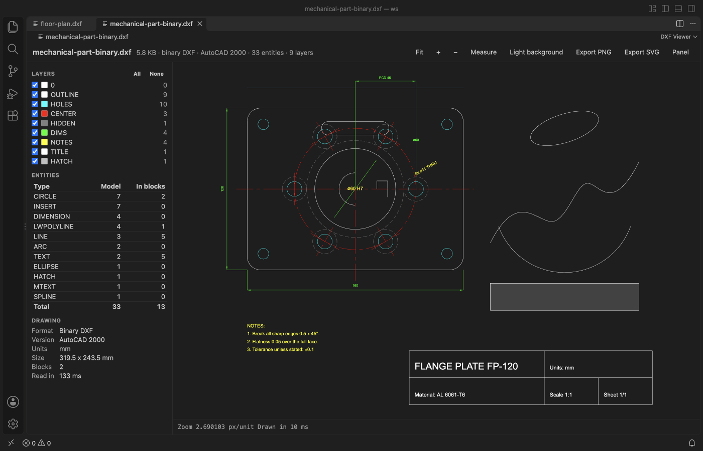
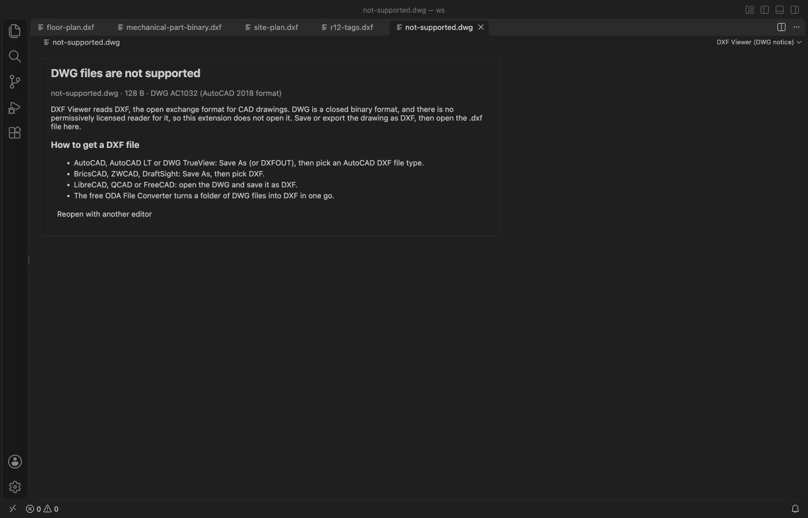

# DXF Viewer & CAD Viewer for 2D Drawings

Open `.dxf` drawings in VS Code and check layers, sizes and distances without leaving the editor or starting a CAD program.

*Screenshot of VS Code 1.142 with a floor plan made by `scripts/make-samples.js`.*

- Reads ASCII and binary DXF, from R12 to AutoCAD 2018 files, with blocks, nested inserts, text, dimensions and hatches.
- Hide or show each layer, see how many entities of each type the file holds, and measure with snapping to ends and centres.
- Save the view as a PNG image or an SVG file for a ticket, a pull request or the docs.
- Works offline. The drawing is never changed.

## Quick start

1. Install DXF Viewer & CAD Viewer for 2D Drawings.
2. Click a `.dxf` file in the Explorer.

## What you can do

| Action | How |
|---|---|
| Pan | Drag with the mouse, or use the arrow keys |
| Zoom | Scroll at the point you want, or the + and − buttons |
| Fit the drawing | Fit button, F, or a double-click |
| Hide a layer | Untick it in the Layers panel. All and None switch every layer |
| Measure | Measure button or M, then click two points. You get the distance in the drawing units, ΔX, ΔY and the angle. Copy puts the line on the clipboard |
| Background | Dark like most CAD programs, or white like a printed sheet (B) |
| Export | Export PNG saves the view at twice the screen resolution. Export SVG saves the visible layers as paths and text |

The side panel lists the layers with their colour and entity count, a table of entity types (model space and inside blocks), and the drawing facts. These are ASCII or binary, the DXF version, units, size and block count. Layers that are off or frozen in the file start hidden.

## What gets drawn

LINE, CIRCLE, ARC, ELLIPSE, LWPOLYLINE and POLYLINE (bulges too), SPLINE, POINT, SOLID, TRACE, 3DFACE, HATCH (solid fill, pattern hatches as a light tint with their outline), TEXT, MTEXT, ATTRIB, INSERT with arrays and nested blocks, DIMENSION and LEADER. Dimensions use the block the CAD program saved with them, and when it's missing the viewer draws them from their definition points.

Colours follow the layer, the block or the entity (ACI and true colour). Dashed and centre linetypes come from the file. Other entity types, such as 3DSOLID, IMAGE or XLINE, are counted in the table and marked as not drawn.

## DWG files

DWG isn't supported. It's a closed binary format with no permissively licensed reader. When you click a `.dwg` file, DXF Viewer shows a short page with the DWG version and how to get a DXF copy.

- AutoCAD, AutoCAD LT or DWG TrueView. Use Save As (or DXFOUT) and pick an AutoCAD DXF type.
- BricsCAD, ZWCAD or DraftSight. Use Save As and pick DXF.
- LibreCAD, QCAD or FreeCAD. Open the DWG and save it as DXF.
- The free ODA File Converter converts a whole folder of DWG files at once.

If you use another extension for DWG files, the page has a button to reopen the file with it.

## Big files

The file is read in a worker thread, so VS Code stays responsive while it loads. A 24 MB drawing with 600,000 lines is read in about one second. Files over 500 MB show a message and are not read (setting `dxfViewer.maxFileMB`, up to 2048).

## Settings

| Setting | Default | What it does |
|---|---|---|
| `dxfViewer.maxFileMB` | 500 | Largest file to read. |
| `dxfViewer.background` | auto | Background when a file opens. `auto` follows the VS Code theme. |
| `dxfViewer.askForRating` | true | Ask one time for a rating after a few days of use. |

## Privacy

DXF Viewer makes no network calls and sends no telemetry. The webview runs under a strict Content Security Policy, and text from the drawing is drawn as text, never as HTML. The only file it writes is an export you pick in the save dialog, and it refuses to write over a drawing.

## Limits

- Model space only. Paper space layouts and viewports are not shown, and the panel says how many paper space entities were skipped.
- 3D entities are drawn flat (top view). 3DSOLID, REGION and BODY hold ACIS data and are not drawn.
- Text uses a sans-serif font, not the SHX or TrueType font named in the file, so text widths differ a little from CAD.
- Line weights are not used. Every line is one pixel wide at any zoom.
- Pattern hatches show as a light tint, not as the pattern lines.

## Support

Zovo extensions have no ads and no tracking, and sponsors pay for the time that goes into fixes and new viewers. You can sponsor the work on [GitHub Sponsors](https://github.com/sponsors/theluckystrike).

## More viewers by Zovo

- [Context Drift](https://marketplace.visualstudio.com/items?itemName=zovo.context-drift) finds stale facts in AGENTS.md, CLAUDE.md and other agent rule files.
- [PDF Viewer & Reader with Dark Mode](https://marketplace.visualstudio.com/items?itemName=zovo.pdf-viewer-dark) reads PDFs with a real dark mode, search, an outline and thumbnails.
- [CSV, Excel & Parquet Viewer](https://marketplace.visualstudio.com/items?itemName=zovo.table-viewer-vscode) opens Parquet, Excel and CSV files as a sortable, filterable table.
- [DOCX Viewer & Word Viewer](https://marketplace.visualstudio.com/items?itemName=zovo.docx-viewer-vscode) previews Word files with dark mode, an outline and search.
- [HDF5 & NetCDF Explorer](https://marketplace.visualstudio.com/items?itemName=zovo.hdf5-netcdf-explorer) browses groups, variables and attributes in scientific data files.
- [PPTX Viewer for PowerPoint](https://marketplace.visualstudio.com/items?itemName=zovo.pptx-slide-viewer) shows PowerPoint slides, thumbnails and speaker notes.
- [Skill Shelf](https://marketplace.visualstudio.com/items?itemName=zovo.skill-shelf) lists, checks and toggles the Agent Skills that Claude Code, Codex and Cursor load.
- [Tensor Viewer](https://marketplace.visualstudio.com/items?itemName=zovo.tensor-viewer) shows NPY, NPZ, Safetensors and GGUF tensors with stats and heatmaps.

Coming soon to the Marketplace, with the code on GitHub now.

- [JSONL Viewer](https://github.com/theluckystrike/jsonl-viewer-vscode) opens JSONL and NDJSON files as a table, as records or as a chat view.
- [SQLite Table Viewer](https://github.com/theluckystrike/sqlite-table-viewer) browses SQLite tables read-only and runs SELECT queries.
- [Agent Session Viewer](https://github.com/theluckystrike/agent-session-viewer) browses and searches your local Claude Code and Codex sessions.
- [Audio Preview & Loudness Meter](https://github.com/theluckystrike/audio-preview-vscode) plays audio files with a waveform, a spectrogram and LUFS loudness.
- [Video Preview with Sound](https://github.com/theluckystrike/video-preview-vscode) plays MP4, MOV, MKV and WebM files with their sound.
- [Graphviz Preview & DOT Viewer](https://github.com/theluckystrike/graphviz-preview-vscode) shows a live preview of DOT files and exports SVG or PNG.
- [TIFF Viewer](https://github.com/theluckystrike/tiff-viewer-vscode) opens 16-bit, float, multi-page and GeoTIFF images.
- [Avro, Arrow & Feather Viewer](https://github.com/theluckystrike/arrow-avro-viewer-vscode) opens Avro, Arrow and Feather files as a paged table.
- [EML & MBOX Email Viewer](https://github.com/theluckystrike/eml-viewer-vscode) reads email files with remote images blocked.
- [3D Model Viewer](https://github.com/theluckystrike/model-viewer-vscode) views GLB, glTF, STL, OBJ, PLY and 3MF models.
- [JSON Viewer & JSON Tree](https://github.com/theluckystrike/json-tree-viewer-vscode) shows large JSON files as a searchable tree, copies JSONPath and turns arrays of objects into a table.
- [PKL Viewer & Pickle Viewer](https://github.com/theluckystrike/pickle-viewer-vscode) opens Python pickle files without Python and never runs their code.
- [Claude Code & Codex Usage Meter](https://github.com/theluckystrike/ai-usage-meter-vscode) shows Claude Code and Codex tokens and estimated cost from your local session files.
- [File Viewers Pack](https://github.com/theluckystrike/zovo-file-viewers) installs the PDF, table, Word, PowerPoint, HDF5 and tensor viewers in one step.

## License

MIT. DXF Viewer uses no third-party runtime code. The DXF reader, the renderer and the sample drawings were written for this extension.
